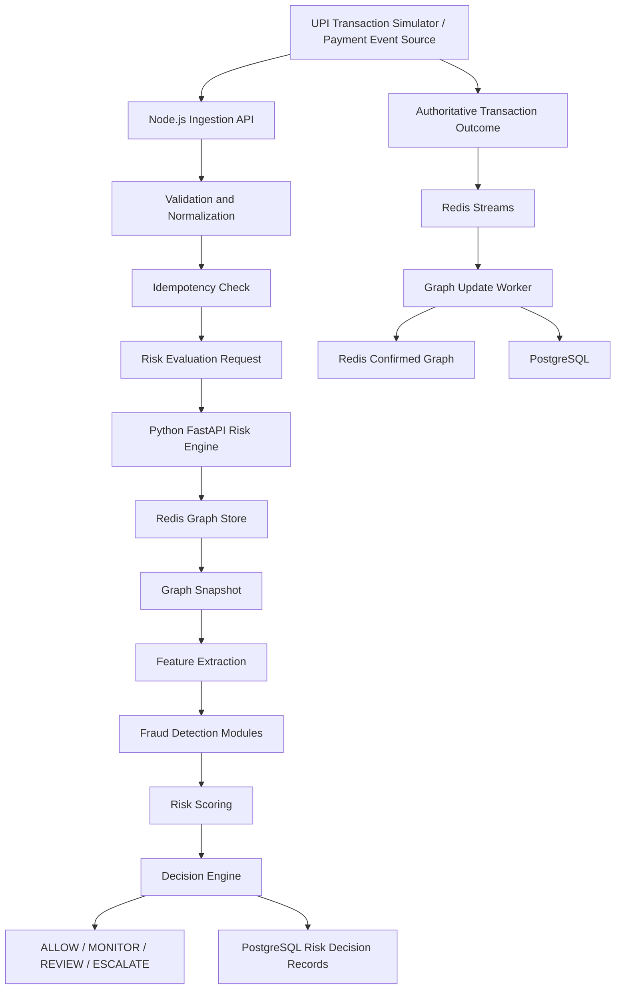
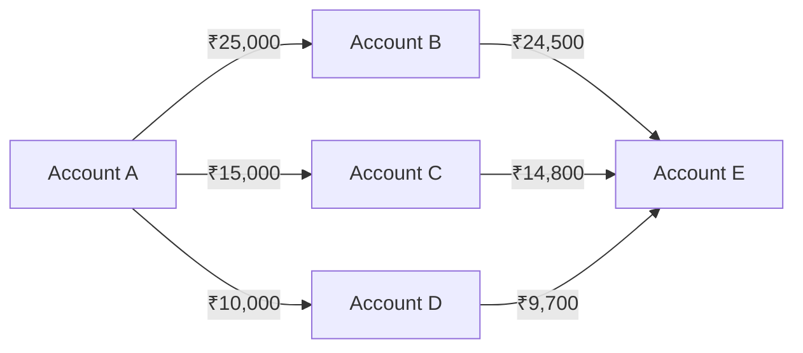
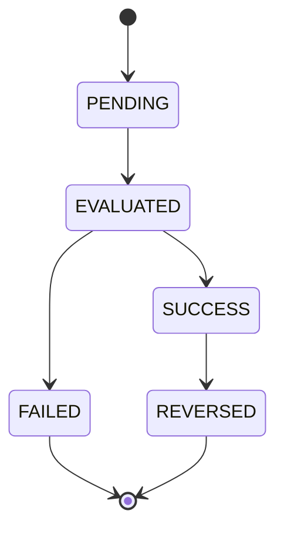

# UPI Money Mule & Collusion Detection Engine

A real-time, graph-based fraud detection engine designed to identify suspicious UPI transaction networks, money mule accounts, and coordinated financial activity before payment settlement.

---

## 1. Project Overview

Traditional transaction monitoring systems primarily evaluate individual transactions using predefined rules, such as transaction amount limits, transaction frequency, or suspicious account activity.

However, organized financial fraud often involves multiple intermediary accounts that transfer funds rapidly across a network. These accounts may appear legitimate when examined individually, while their relationships reveal suspicious behavior.

This project addresses that limitation through **real-time transaction graph analysis**.

The engine continuously maintains a directed, weighted, and time-aware transaction graph. When a new transaction is proposed, it examines the relevant account neighborhood, identifies suspicious transaction patterns, calculates risk, and returns an explainable risk decision.

### Core objectives

- Detect suspicious multi-hop money movement.
- Identify fan-out and fan-in transaction patterns.
- Detect rapid fund pass-through behavior.
- Identify circular transaction flows.
- Discover suspicious relationships between accounts.
- Calculate transaction-level and account-level risk scores.
- Generate explainable fraud signals.
- Support low-latency graph analysis with a target of under 100 ms p95 evaluation time under a defined benchmark workload.

### Core detection capabilities

| Detection module | Purpose |
|---|---|
| Fan-out detection | Identifies accounts distributing funds to many recipients rapidly. |
| Fan-in detection | Identifies accounts receiving funds from many senders. |
| Pass-through detection | Identifies accounts that quickly forward received funds. |
| Cycle detection | Detects circular transaction flows between accounts. |
| Multi-hop detection | Finds suspicious paths involving multiple intermediary accounts. |
| Risk scoring | Combines detection signals into an explainable risk score. |

---

## 2. Technology Stack

The architecture uses separate components for transaction ingestion, graph state management, real-time analysis, and durable storage.

| Component | Technology | Responsibility |
|---|---|---|
| Ingestion API | Node.js | Receives and validates transaction events. |
| Event streaming | Redis Streams | Transfers transaction events to background workers. |
| Live graph storage | Redis | Stores account adjacency indexes and recent transaction history. |
| Graph analysis | Python | Performs traversal, feature extraction, and fraud detection. |
| API framework | FastAPI | Exposes graph risk evaluation endpoints. |
| Persistent database | PostgreSQL | Stores accounts, transactions, decisions, and evidence. |
| ORM | Prisma | Manages database schema and migrations. |
| Optional ML | Scikit-learn | Supports future anomaly detection experiments. |

### Why this stack?

- **Node.js:** Efficient transaction ingestion and API orchestration.
- **Redis:** Low-latency access to recent account relationships.
- **Redis Streams:** Reliable event consumption with consumer groups and pending-message recovery.
- **Python:** Convenient implementation of graph algorithms and numerical risk calculations.
- **FastAPI:** Lightweight asynchronous API framework.
- **PostgreSQL:** Durable, relational storage for transaction history and audit records.

The initial implementation deliberately avoids introducing Neo4j, Kafka, or Graph Neural Networks. Redis-based adjacency indexes and bounded graph traversal are sufficient for the first working engine.

---

## 3. High-Level Architecture

The engine uses two connected processing paths:

1. **Synchronous risk evaluation:** Evaluates a proposed transaction before settlement.
2. **Asynchronous graph maintenance:** Updates the confirmed transaction graph after receiving the authoritative transaction outcome.

This separation is essential. A proposed transaction must not become a confirmed graph edge before the payment actually succeeds.

### Architecture diagram



### Component responsibilities

**Node.js Ingestion API**

- Accepts transaction events.
- Validates required fields.
- Normalizes transaction data.
- Enforces transaction ID uniqueness.
- Calls the risk evaluation service.
- Publishes authoritative transaction outcomes to Redis Streams.

**Python Graph Engine**

- Retrieves relevant graph neighborhoods.
- Builds bounded graph snapshots.
- Extracts graph-based features.
- Runs fraud detection algorithms.
- Calculates risk scores.
- Produces explainable decisions.

**Redis**

- Maintains incoming and outgoing transaction indexes.
- Stores recent transaction relationships.
- Maintains rolling account activity information.
- Supports fast graph neighborhood retrieval.

**PostgreSQL**

- Stores account records.
- Stores confirmed transaction records.
- Stores risk decisions and fraud evidence.
- Maintains historical account risk information.

---

## 4. Transaction Processing Architecture

### 4.1 Synchronous risk evaluation

When a proposed transaction arrives, the engine evaluates it without immediately inserting it into the confirmed transaction graph.

Example:

```text
Transaction:
Sender: ACC001
Receiver: ACC002
Amount: ₹25,000
Status: PENDING
```

Processing sequence:

1. Receive the proposed transaction.
2. Validate its structure and identifiers.
3. Retrieve the sender's and receiver's relevant graph neighborhoods.
4. Construct a temporary candidate edge.
5. Extract graph-based features.
6. Execute the fraud detection modules.
7. Calculate the risk score.
8. Generate a decision with supporting evidence.
9. Return the result to the authorized payment integration.

Possible response:

```json
{
  "transaction_id": "TXN1001",
  "risk_score": 82.5,
  "decision": "ESCALATE",
  "patterns": [
    "FAN_OUT",
    "RAPID_PASS_THROUGH",
    "MULTI_HOP"
  ],
  "evidence": {
    "unique_receivers_30s": 12,
    "pass_through_ratio": 0.94,
    "max_suspicious_path_depth": 3
  }
}
```

### 4.2 Asynchronous graph maintenance

After the authoritative payment system reports the transaction outcome, the engine updates its confirmed graph.

```text
Payment outcome received
        |
        v
Publish event to Redis Streams
        |
        v
Graph update worker
        |
        v
Validate event and check idempotency
        |
        v
Update Redis adjacency indexes
        |
        v
Persist transaction in PostgreSQL
```

Only successful transactions should create confirmed transaction edges.

Failed transactions must not be treated as completed transfers. Reversals should be processed as compensating events linked to the original transaction.

### Important integration boundary

This project is a risk intelligence engine. It does not independently settle, block, reverse, or intercept real UPI payments.

In a production integration, an authorized bank, payment service provider, or other permitted payment participant would consume the engine's risk recommendation and apply its own transaction policy.

---

## 5. Transaction Data Model

Every transaction must contain sufficient information to reconstruct its position in the transaction graph.

### Transaction event

```typescript
interface TransactionEvent {
  transactionId: string;

  senderId: string;
  receiverId: string;

  amount: number; // Integer paise
  currency: "INR";

  eventTimestamp: number;
  receivedTimestamp: number;

  deviceIdHash?: string;

  status:
    | "PENDING"
    | "SUCCESS"
    | "FAILED"
    | "REVERSED";
}
```

### Important fields

| Field | Description |
|---|---|
| transactionId | Unique transaction identifier. |
| senderId | Account initiating the transfer. |
| receiverId | Account receiving the transfer. |
| amount | Transaction amount in integer paise. |
| eventTimestamp | Time at which the transaction occurred. |
| receivedTimestamp | Time at which the engine received the event. |
| deviceIdHash | Optional pseudonymous device identifier. |
| status | Current transaction lifecycle state. |

**Use integer paise instead of floating-point rupees.**

For example:

```text
₹25,000 = 2,500,000 paise
```

This avoids floating-point precision problems in financial calculations.

The event timestamp and received timestamp must remain separate because transactions may arrive late or out of order.

### Account model

```typescript
interface Account {
  accountId: string;

  accountAgeDays?: number;

  createdAt: number;

  deviceHashes?: string[];

  accountStatus:
    | "ACTIVE"
    | "RESTRICTED"
    | "CLOSED";
}
```

Account age and device information are contextual risk signals. They must not independently establish fraudulent activity.

---

## 6. Transaction Graph Design

The central component of the engine is its transaction graph.

Represent the transaction network as:

\[
G_t = (V,E_t)
\]

Where:

- \(V\) represents financial accounts.
- \(E_t\) represents transactions observed up to time \(t\).

Each transaction is represented as:

\[
e = (u,v,a,\tau,id)
\]

Where:

- \(u\): Sender account.
- \(v\): Receiver account.
- \(a\): Transaction amount.
- \(\tau\): Transaction timestamp.
- \(id\): Transaction identifier.

### Why a directed, weighted, temporal multigraph?

**Directed:** A transaction from A to B is different from a transaction from B to A.

**Weighted:** The amount transferred is important for identifying suspicious money movement.

**Temporal:** The time between transfers can reveal rapid fund movement.

**Multigraph:** Multiple transactions may occur between the same two accounts.

### Example transaction network



In this example:

- Account A demonstrates fan-out behavior.
- Account E demonstrates fan-in behavior.
- Accounts B, C, and D may act as intermediaries.
- The network structure can be suspicious even if each individual transaction appears normal.

---

## 7. Redis Graph Storage Architecture

The engine uses Redis adjacency indexes rather than scanning the entire transaction database.

### Key structure

```text
graph:ACC001:out
graph:ACC001:in

account:ACC001:metadata

txn:TXN001

processed:TXN001

risk:ACC001
```

### Outgoing adjacency index

Stores transactions sent by an account.

```text
graph:ACC001:out

TXN001 | ACC002 | 2500000
TXN002 | ACC003 | 1500000
TXN003 | ACC004 | 1000000
```

### Incoming adjacency index

Stores transactions received by an account.

```text
graph:ACC005:in

TXN004 | ACC002 | 2450000
TXN005 | ACC003 | 1480000
TXN006 | ACC004 | 970000
```

Use Redis Sorted Sets with transaction timestamps as scores so that recent transactions can be retrieved efficiently.

Example:

```redis
ZADD graph:ACC001:out 1794651000 "TXN001|ACC002|2500000"
```

Retrieve transactions from a recent time window:

```redis
ZRANGEBYSCORE graph:ACC001:out 1794650700 1794651000
```

The timestamp values above are illustrative.

### Redis design principles

- Maintain separate incoming and outgoing indexes.
- Retrieve only the required time window.
- Use Redis pipelining for multiple account lookups.
- Use atomic updates or Lua scripts for related index changes.
- Implement idempotency before adding graph edges.
- Use TTL or time-bucket cleanup for temporary state where appropriate.
- Keep durable historical records in PostgreSQL.

Redis is the live graph state store, not the permanent source of transaction history.

---

## 8. Event Ingestion Pipeline

Node.js receives transaction events and publishes them to Redis Streams.

### Ingestion responsibilities

1. Validate the transaction payload.
2. Normalize amounts and timestamps.
3. Check transaction ID uniqueness.
4. Reject malformed events.
5. Call the synchronous risk evaluation endpoint when required.
6. Publish authoritative outcomes to Redis Streams.

### Example Redis Stream event

```redis
XADD transactions * \
transactionId TXN001 \
senderId ACC001 \
receiverId ACC002 \
amount 2500000 \
eventTimestamp 1794651000 \
status SUCCESS
```

### Consumer group

The Python worker consumes events through a Redis Stream consumer group.

```redis
XGROUP CREATE transactions graph-workers $ MKSTREAM
```

Example consumption:

```redis
XREADGROUP GROUP graph-workers worker-1 \
COUNT 10 BLOCK 1000 \
STREAMS transactions >
```

### Reliability requirements

- Idempotent transaction processing.
- Consumer group pending-message recovery.
- Retry limits.
- Dead-letter handling for invalid or repeatedly failing events.
- Stream lag monitoring.
- Recovery using `XAUTOCLAIM` where appropriate.

Redis Streams provide durable event delivery capabilities, but application-level idempotency is still necessary. Do not assume exactly-once processing.

---

## 9. Temporal Graph Traversal

Graph traversal is used to discover relationships between accounts and identify suspicious multi-hop transaction paths.

The engine must avoid exploring the entire transaction network for every proposed payment.

Instead, it uses bounded traversal.

### Initial traversal configuration

```python
GRAPH_CONFIG = {
    "time_window_seconds": 300,
    "max_depth": 4,
    "max_nodes": 500,
    "max_edges": 1500
}
```

These are initial tuning parameters, not fixed fraud rules.

### 9.1 Breadth-First Search (BFS)

BFS explores nearby accounts level by level.

It is useful for discovering multi-hop transaction relationships.

Example:

```text
Account A
   |
   v
Account B
   |
   v
Account C
   |
   v
Account D
```

Conceptual algorithm:

```python
from collections import deque

def bounded_bfs(start_node, graph, max_depth=4, max_nodes=500):

    queue = deque([(start_node, 0)])
    visited = {start_node}

    while queue and len(visited) <= max_nodes:

        node, depth = queue.popleft()

        if depth >= max_depth:
            continue

        for neighbor in graph.get_neighbors(node):

            if neighbor in visited:
                continue

            visited.add(neighbor)

            queue.append((neighbor, depth + 1))

    return visited
```

The production implementation must additionally:

- Apply the temporal window.
- Preserve transaction IDs and edge details.
- Track transaction timestamps and amounts.
- Enforce an edge examination budget.
- Handle incoming and outgoing directions correctly.
- Return incomplete-evidence status when traversal limits are reached.

### 9.2 Depth-First Search (DFS)

DFS is useful for identifying circular transaction flows.

Example:

```text
A → B → C → D → A
```

The engine can identify cycles within a bounded neighborhood and time window.

However, a cycle does not automatically indicate fraud. Its duration, amount movement, repetition, and other supporting evidence must be considered.

Equivalent rotations of the same cycle should be canonicalized to avoid counting them as different cycles.

### 9.3 Temporal path validation

A multi-hop path should satisfy chronological ordering:

\[
t_1 \leq t_2 \leq t_3
\]

The complete path must also fit within the configured time window:

\[
t_{\text{last}} - t_{\text{first}} \leq W
\]

Where \(W\) is the configured observation window.

The engine must distinguish event time from processing time and define a bounded-lateness policy for out-of-order events.

---

## 10. Core Fraud Detection Modules

Each detection module evaluates a different type of suspicious graph behavior.

### 10.1 Fan-Out Detection

**Objective:** Identify accounts that rapidly distribute funds to many unique recipients.

Example:

```text
             B
            /
           /
A -------- C
           \
            \
             D
              \
               E
```

Account A sends money to several different accounts within a short interval.

### Features

- Number of outgoing transactions.
- Number of unique receivers.
- Total outgoing amount.
- Transaction frequency.
- Time span of outgoing transfers.
- Amount distribution.

Example:

```json
{
  "pattern": "FAN_OUT",
  "detected": true,
  "severity": "HIGH",
  "features": {
    "unique_receivers": 12,
    "time_window_seconds": 30,
    "transaction_count": 15
  }
}
```

### 10.2 Fan-In Detection

**Objective:** Identify accounts receiving money from many unique senders within a short time window.

Example:

```text
A ----\
B -----\
C ------> X
D -----/
E ----/
```

### Features

- Number of incoming transactions.
- Number of unique senders.
- Total incoming amount.
- Incoming transaction velocity.
- Repeated amount patterns.
- Subsequent outgoing activity.

A high number of incoming transactions alone is not proof of suspicious activity. The engine should evaluate the surrounding network behavior.

### 10.3 Rapid Pass-Through Detection

**Objective:** Identify accounts that receive funds and rapidly forward them to other accounts.

Example:

```text
Account A
   |
   | ₹25,000
   v
Account B
   |
   | ₹24,500
   v
Account C
```

Account B receives ₹25,000 and forwards ₹24,500 shortly afterward.

### Important features

- Incoming amount.
- Outgoing amount.
- Holding time.
- Amount retained.
- Pass-through ratio.

The pass-through ratio can be estimated as:

\[
PTR = \frac{\text{Matched outgoing amount}}
{\text{Incoming amount}}
\]

For example:

\[
PTR = \frac{24500}{25000} = 0.98
\]

A high pass-through ratio combined with a short holding time may indicate suspicious fund movement.

For the initial implementation, FIFO allocation can be used to approximately match incoming and outgoing amounts. This is an analytical approximation, not definitive tracing of individual currency units.

### 10.4 Circular Transaction Detection

**Objective:** Identify money moving through a sequence of accounts and eventually returning to an earlier account.

Example:

```text
A → B → C → D → A
```

### Features

- Cycle length.
- Cycle completion time.
- Amount similarity.
- Number of repeated cycles.
- Transaction velocity.
- Amount retained or lost.

Use bounded DFS and canonical cycle representation.

A cycle should be treated as supporting evidence rather than automatic proof of fraud.

### 10.5 Multi-Hop Money Flow Detection

**Objective:** Identify suspicious transaction paths involving multiple intermediary accounts.

Example:

```text
A → B → C → D → E
```

### Features

- Number of intermediary accounts.
- Path depth.
- Time elapsed between transfers.
- Amount transferred at each hop.
- Estimated retained amount.
- Existing suspicious account relationships.
- Supporting fan-in, fan-out, and pass-through signals.

The traversal must be bounded to avoid expensive enumeration of every possible path.

Prioritize paths based on temporal proximity, transaction amount, and supporting risk signals.

---

## 11. Shared Graph Feature Extraction

All detection modules should use a shared graph snapshot and feature extraction layer.

This avoids repeated Redis lookups and duplicate calculations.

### Account-level features

| Feature | Description |
|---|---|
| `in_degree_5m` | Unique incoming counterparties in five minutes. |
| `out_degree_5m` | Unique outgoing counterparties in five minutes. |
| `incoming_txn_count` | Number of recent incoming transactions. |
| `outgoing_txn_count` | Number of recent outgoing transactions. |
| `incoming_amount` | Total recent incoming amount. |
| `outgoing_amount` | Total recent outgoing amount. |
| `transaction_velocity` | Transaction frequency over the selected interval. |
| `pass_through_ratio` | Estimated forwarded amount divided by incoming amount. |
| `cycle_detected` | Whether a relevant cycle was detected. |
| `max_connected_depth` | Maximum relevant traversal depth. |
| `risky_neighbor_count` | Number of known or previously flagged neighbors. |
| `unique_device_count` | Number of distinct pseudonymous device identifiers. |

Keep transaction counts, unique counterparties, incoming volume, and outgoing volume as separate features.

### Feature extraction pipeline

```text
Graph Snapshot
      |
      v
Temporal Filtering
      |
      v
Account Statistics
      |
      v
Transaction Velocity
      |
      v
Network Features
      |
      v
Shared Feature Object
      |
      v
Detection Modules
```

---

## 12. Risk Scoring Engine

The risk engine combines evidence from multiple detection modules.

Each detector returns structured results containing:

- Pattern name.
- Detection status.
- Severity.
- Supporting features.
- Relevant transaction IDs.
- Involved account IDs.
- Observation time window.

### Example detection output

```python
{
    "pattern": "FAN_OUT",
    "detected": True,
    "severity": "HIGH",
    "features": {
        "unique_receivers": 12,
        "time_window_seconds": 30
    }
}
```

### Weighted risk score

The initial engine uses a weighted scoring model:

\[
R = \sum_{i=1}^{n} w_i s_i
\]

Where:

- \(w_i\) is the weight assigned to a detection signal.
- \(s_i\) is its normalized signal strength between 0 and 1.

Illustrative initial weights:

```python
WEIGHTS = {
    "fan_out": 0.20,
    "fan_in": 0.20,
    "pass_through": 0.25,
    "cycle": 0.15,
    "multi_hop": 0.20
}
```

Example signal strengths:

```python
signals = {
    "fan_out": 1.0,
    "fan_in": 0.8,
    "pass_through": 0.95,
    "cycle": 0.0,
    "multi_hop": 0.9
}
```

The final result is normalized to a 0–100 scale.

```text
Risk Score = 78.75
```

These weights are illustrative starting values. They must be calibrated against representative validation data. Correlated signals must be handled carefully to avoid double-counting the same underlying behavior.

### Risk decision thresholds

Initial illustrative thresholds:

| Risk score | Decision |
|---|---|
| 0–29 | ALLOW |
| 30–59 | MONITOR |
| 60–79 | REVIEW |
| 80–100 | ESCALATE |

These thresholds are not validated production policy. They should be tuned using labeled datasets and the operating requirements of the integrating payment participant.

### Transaction risk vs account risk

The engine maintains two separate concepts:

**Transaction risk:** Risk associated with a particular proposed transaction.

**Account risk:** Historical and network-based risk associated with an account.

An account with a high historical risk score does not automatically make every transaction fraudulent. Similarly, a suspicious transaction does not necessarily establish that every involved account is malicious.

### Explainable evidence

Every decision should contain:

- Risk score.
- Decision.
- Triggered patterns.
- Supporting feature values.
- Relevant transaction IDs.
- Involved accounts.
- Observation time window.
- Scoring configuration or model version.

The score represents analytical risk, not proof of criminal activity.

---

## 13. Transaction Lifecycle and State Management

The engine must correctly handle different transaction outcomes.



### Processing rules

| Transaction state | Graph behavior |
|---|---|
| PENDING | Evaluate using a temporary candidate edge. |
| SUCCESS | Add the confirmed transaction edge. |
| FAILED | Do not add a confirmed transaction edge. |
| REVERSED | Apply a compensating graph update linked to the original transaction. |

Additional requirements:

- Prevent duplicate transaction insertion.
- Handle concurrent updates involving the same account.
- Handle out-of-order events.
- Preserve the original transaction when a reversal occurs.
- Recompute affected account features where necessary.
- Record transaction state transitions for auditing.

For the initial MVP, a single sequential graph update worker is a reasonable starting point.

---

## 14. API Design

The Python service exposes endpoints for graph risk evaluation and health monitoring.

### 14.1 Evaluate transaction risk

```http
POST /api/v1/risk/evaluate
Content-Type: application/json
```

Request:

```json
{
  "transactionId": "TXN1001",
  "senderId": "ACC001",
  "receiverId": "ACC002",
  "amount": 2500000,
  "currency": "INR",
  "eventTimestamp": 1794651000
}
```

Response:

```json
{
  "transactionId": "TXN1001",
  "riskScore": 82.5,
  "decision": "ESCALATE",
  "patterns": [
    "FAN_OUT",
    "RAPID_PASS_THROUGH",
    "MULTI_HOP"
  ],
  "evidence": {
    "uniqueReceivers": 12,
    "passThroughRatio": 0.94,
    "maxPathDepth": 3
  },
  "processingStatus": "COMPLETE"
}
```

### 14.2 Publish transaction outcome

```http
POST /api/v1/transactions/outcome
Content-Type: application/json
```

Request:

```json
{
  "transactionId": "TXN1001",
  "senderId": "ACC001",
  "receiverId": "ACC002",
  "amount": 2500000,
  "eventTimestamp": 1794651000,
  "status": "SUCCESS"
}
```

The service publishes the event for asynchronous graph maintenance.

### 14.3 Health check

```http
GET /health
```

Example response:

```json
{
  "status": "healthy",
  "service": "graph-risk-engine"
}
```

### API design considerations

- Validate every request.
- Use consistent error response formats.
- Enforce idempotency for transaction outcomes.
- Keep risk evaluation separate from confirmed graph updates.
- Return evidence and processing status.
- Define timeouts and failure behavior between Node.js and Python.

---

## 15. PostgreSQL Database Design

PostgreSQL stores durable account information, transaction history, risk decisions, and fraud evidence.

It should not be used to scan the entire transaction network during real-time graph traversal.

### Main tables

| Table | Responsibility |
|---|---|
| `accounts` | Account metadata. |
| `transactions` | Confirmed transaction history. |
| `risk_decisions` | Risk scores and final decisions. |
| `fraud_signals` | Individual detected graph patterns. |
| `account_risk_history` | Historical account-level risk scores. |
| `processing_events` | Transaction processing and lifecycle events. |

### Prisma schema

```prisma
enum TransactionStatus {
  PENDING
  SUCCESS
  FAILED
  REVERSED
}

enum RiskDecisionType {
  ALLOW
  MONITOR
  REVIEW
  ESCALATE
}

model Account {
  id            String   @id @default(uuid())
  accountRef    String   @unique
  accountAgeDays Int?
  createdAt     DateTime @default(now())

  sentTransactions     Transaction[] @relation("Sender")
  receivedTransactions Transaction[] @relation("Receiver")
}

model Transaction {
  id             String            @id @default(uuid())
  transactionRef String            @unique

  senderId       String
  receiverId     String

  amountPaise    BigInt

  eventTimestamp DateTime
  status         TransactionStatus

  createdAt      DateTime @default(now())

  sender Account @relation(
    "Sender",
    fields: [senderId],
    references: [id]
  )

  receiver Account @relation(
    "Receiver",
    fields: [receiverId],
    references: [id]
  )

  @@index([senderId, eventTimestamp])
  @@index([receiverId, eventTimestamp])
}

model RiskDecision {
  id             String           @id @default(uuid())
  transactionRef String

  riskScore      Float
  decision       RiskDecisionType

  modelVersion   String
  evidence       Json

  createdAt      DateTime @default(now())

  @@index([transactionRef])
  @@index([createdAt])
}

model FraudSignal {
  id                  String   @id @default(uuid())

  transactionRef      String?
  patternType         String
  severity            String

  involvedAccountIds  Json
  evidenceTransactionIds Json
  features            Json

  createdAt           DateTime @default(now())

  @@index([patternType])
  @@index([createdAt])
}
```

This is a starting schema. A complete implementation should also define account risk history, processing event records, reversal relationships, and any additional audit fields required by the integration.

---

## 16. Python Project Structure

Recommended codebase structure:

```text
muleshield-engine/
│
├── ingestion/
│   ├── event_consumer.py
│   ├── event_validator.py
│   └── idempotency.py
│
├── graph/
│   ├── graph_store.py
│   ├── adjacency_manager.py
│   ├── graph_snapshot.py
│   ├── temporal_filter.py
│   └── traversal.py
│
├── detection/
│   ├── fan_out.py
│   ├── fan_in.py
│   ├── pass_through.py
│   ├── cycle_detection.py
│   └── multi_hop.py
│
├── features/
│   ├── feature_extractor.py
│   ├── velocity_features.py
│   └── network_features.py
│
├── risk/
│   ├── risk_scorer.py
│   ├── decision_engine.py
│   └── evidence_builder.py
│
├── services/
│   ├── transaction_service.py
│   └── graph_update_service.py
│
├── api/
│   └── main.py
│
├── config/
│   └── settings.py
│
├── tests/
│   ├── test_fan_out.py
│   ├── test_fan_in.py
│   ├── test_pass_through.py
│   ├── test_cycles.py
│   ├── test_multi_hop.py
│   ├── test_risk_scoring.py
│   └── test_latency.py
│
├── requirements.txt
└── README.md
```

### Responsibilities of important modules

| Module | Responsibility |
|---|---|
| `graph_store.py` | Redis graph access. |
| `graph_snapshot.py` | Retrieves relevant graph neighborhoods. |
| `traversal.py` | Implements bounded BFS and DFS. |
| `temporal_filter.py` | Filters transactions by event time. |
| `feature_extractor.py` | Generates shared graph features. |
| `fan_out.py` | Detects rapid outgoing distributions. |
| `fan_in.py` | Detects rapid incoming collections. |
| `pass_through.py` | Estimates rapid forwarding behavior. |
| `cycle_detection.py` | Detects circular transaction paths. |
| `multi_hop.py` | Finds suspicious multi-account paths. |
| `risk_scorer.py` | Combines detection signals. |
| `decision_engine.py` | Produces risk decisions. |
| `evidence_builder.py` | Builds explainable detection evidence. |

---

## 17. Main Risk Evaluation Flow

The main transaction evaluation service coordinates all graph operations.

```python
async def evaluate_transaction(transaction):

    # 1. Validate proposed transaction
    validate_transaction(transaction)

    # 2. Retrieve relevant graph neighborhood
    graph_snapshot = await graph_store.get_snapshot(
        sender_id=transaction.senderId,
        receiver_id=transaction.receiverId
    )

    # 3. Add temporary candidate edge
    candidate_graph = build_candidate_graph(
        graph_snapshot,
        transaction
    )

    # 4. Extract shared graph features
    features = feature_extractor.extract(
        transaction,
        candidate_graph
    )

    # 5. Run all detection modules
    detection_results = fraud_detector.detect(
        features,
        candidate_graph
    )

    # 6. Calculate risk
    risk_score = risk_scorer.score(
        detection_results
    )

    # 7. Generate decision
    decision = decision_engine.decide(
        risk_score
    )

    # 8. Build explainable evidence
    evidence = evidence_builder.build(
        transaction,
        features,
        detection_results,
        risk_score
    )

    # 9. Persist decision and return result
    return {
        "transaction_id": transaction.transactionId,
        "risk_score": risk_score,
        "decision": decision,
        "evidence": evidence
    }
```

This is orchestration pseudocode. Production code must also implement timeouts, exception handling, concurrency control, idempotency, and incomplete-evidence handling.

---

## 18. Performance and Latency Optimization

The project targets low-latency graph risk evaluation.

The initial performance objective is:

**p95 graph-risk evaluation latency below 100 ms under a clearly defined test workload.**

This is a target, not a measured result.

### Optimization strategies

**1. Redis adjacency indexes**

Retrieve only the recent incoming and outgoing transactions of relevant accounts.

**2. Bounded graph traversal**

Limit maximum depth, nodes, edges, and candidate paths.

**3. Redis pipelining**

Combine multiple graph lookups into fewer network round trips.

**4. Shared graph snapshots**

Avoid fetching the same account neighborhood independently in every detector.

**5. Precomputed rolling counters**

Maintain short-window transaction counts, unique counterparties, and volume statistics incrementally.

**6. Time-bucketed features**

Use short time buckets, such as one-second or ten-second buckets, for velocity calculations.

**7. Incremental graph updates**

Update affected account indexes instead of recalculating the complete graph.

**8. Separate persistence from evaluation**

Keep slow historical database operations outside the critical decision path where safe, while ensuring decisions and events are durably recorded.

### Latency measurement

Measure:

- Request validation time.
- Redis graph lookup time.
- Graph traversal time.
- Feature extraction time.
- Detection execution time.
- Risk scoring time.
- End-to-end evaluation time.

Report:

| Metric | Purpose |
|---|---|
| p50 | Typical latency. |
| p95 | High-percentile latency target. |
| p99 | Tail latency. |
| Throughput | Transactions evaluated per second. |
| Error rate | Failed evaluations. |
| Stream lag | Delay in graph maintenance. |

If a traversal budget is exhausted, return an explicit `INCOMPLETE_EVIDENCE` status. The absence of a discovered path after a truncated