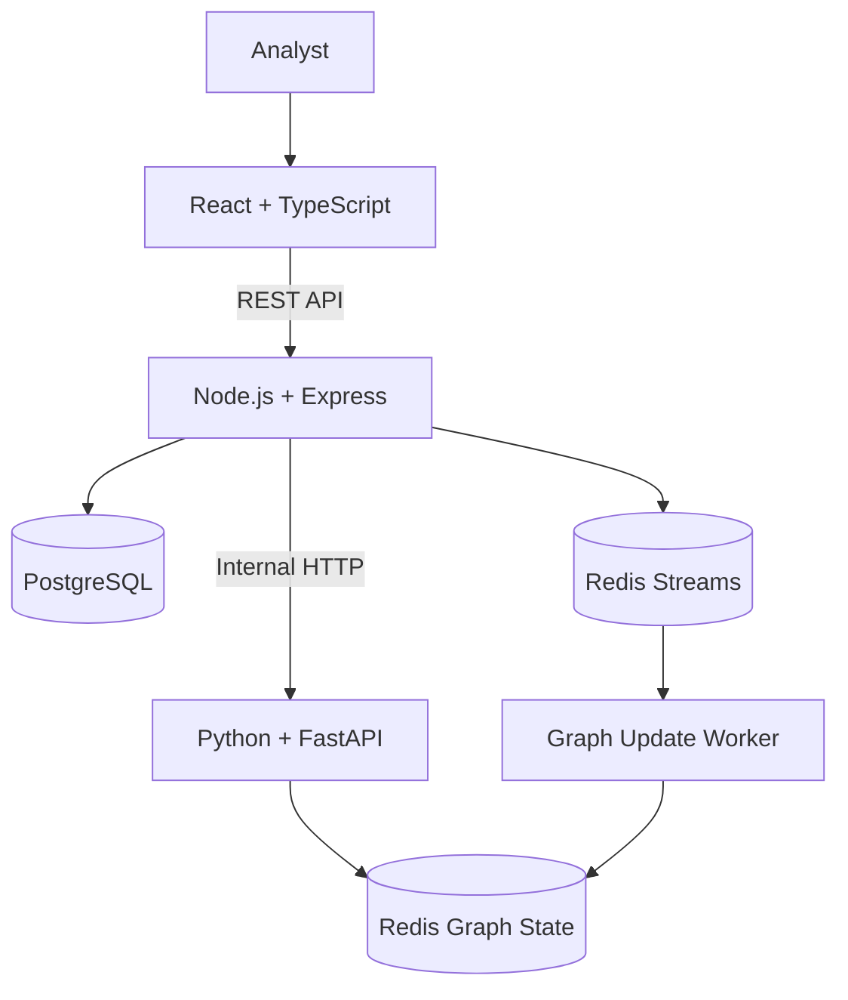
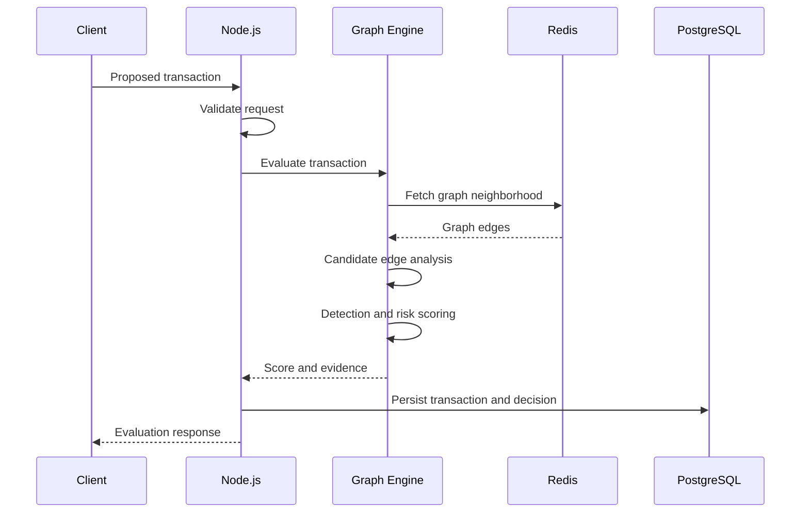
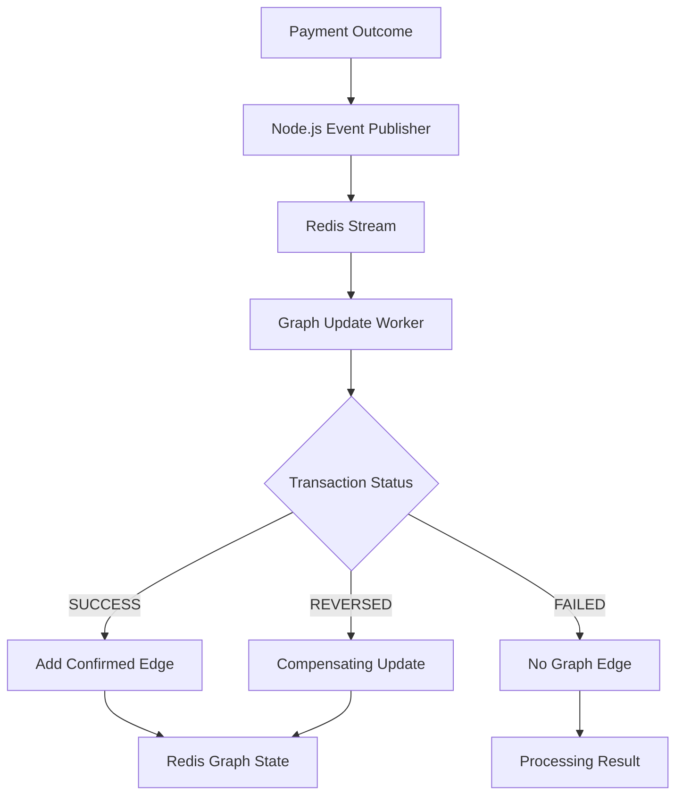

# System Architecture

## 1. Overview

MuleShield consists of three applications and two infrastructure services.

- React frontend
- Node.js backend
- Python graph engine
- Redis
- PostgreSQL

## 2. High-Level Architecture



## 3. Service Responsibilities

### Frontend

- Dashboard and analytics
- Transaction listing and details
- Account profiles
- Interactive transaction graph
- Risk alerts
- Evidence visualization

Graph visualization uses React Flow (`@xyflow/react`).

The frontend only displays graph information received from Node.js.

### Node.js Backend

- Authentication and authorization
- REST API endpoints
- Request validation
- Transaction lifecycle management
- PostgreSQL persistence through Prisma
- Python service communication
- Redis Stream event publishing
- Application orchestration

### Python Graph Engine

- Redis graph retrieval
- Graph snapshots
- Temporal filtering
- BFS and DFS
- Cycle detection
- Fan-in and fan-out detection
- Pass-through detection
- Multi-hop detection
- Feature extraction
- Risk scoring
- Explainable evidence generation

### Redis

Redis stores:

- Incoming adjacency indexes
- Outgoing adjacency indexes
- Recent transaction metadata
- Account graph metadata
- Processing idempotency markers
- Transaction outcome streams

### PostgreSQL

PostgreSQL stores:

- Accounts
- Transactions
- Risk decisions
- Fraud signals
- Account risk history
- Processing events

Node.js and Prisma own PostgreSQL persistence.

## 4. Synchronous Risk Evaluation



The proposed transaction is a temporary candidate edge. It must not become a confirmed graph edge before an authoritative successful payment outcome.

## 5. Asynchronous Graph Maintenance



Use one clearly defined event-consumer ownership model.

Recommended MVP approach:

- Python consumes graph-update events and modifies Redis graph state.
- Python publishes processing acknowledgements.
- Node.js consumes acknowledgements and persists processing status in PostgreSQL.

Do not allow two independent workers to race to update the same business records.

## 6. Graph Model

Represent the network as a directed, weighted, temporal multigraph:

G(t) = (V, E)

Each edge contains:

- Sender account
- Receiver account
- Transaction amount
- Event timestamp
- Transaction ID

## 7. Redis Key Design

```text
graph:{account_id}:out
graph:{account_id}:in
account:{account_id}:metadata
txn:{transaction_id}
processed:{transaction_id}
risk:{account_id}
```

Use Redis Sorted Sets for time-ordered adjacency indexes.

Use atomic operations or Lua scripts when updating sender and receiver indexes.

## 8. Reliability

- **Implemented:** Redis consumer group `graph-workers` consumes `transaction-outcomes`.
- **Implemented:** messages are acknowledged with `XACK` only after graph processing succeeds.
- **Implemented:** pending messages are recovered with `XAUTOCLAIM` after the configured idle delay.
- **Implemented:** failed messages use bounded exponential retry/backoff.
- **Implemented:** messages exceeding `REDIS_MAX_ATTEMPTS` are copied to `transaction-outcomes:dead-letter`.
- **Implemented:** outcome processing uses event IDs and Redis idempotency markers.
- **Planned:** out-of-order event policy, reconciliation jobs, and reversal compensation across all historical graph edges.

Redis Streams do not provide application-level exactly-once processing. The Node.js consumer is therefore idempotent and uses explicit acknowledgement, retry, and dead-letter boundaries.

## 9. Implementation Boundary

The current infrastructure implementation intentionally includes only Redis stream reliability:

| Capability | Status |
|---|---|
| Consumer groups | Implemented |
| `XACK` acknowledgement | Implemented |
| `XAUTOCLAIM` recovery | Implemented |
| Retry/backoff | Implemented |
| Dead-letter stream | Implemented |
| Reconciliation jobs | Planned |
| Out-of-order event policy | Planned |
| Distributed tracing and metrics | Planned |
| Production secret rotation | Planned |

## 9. Performance

Optimize through:

- Bounded graph traversal
- Redis pipelining
- Shared graph snapshots
- Incremental feature updates
- Cached account metadata
- Limited path enumeration

Return `INCOMPLETE_EVIDENCE` when traversal limits are reached.
